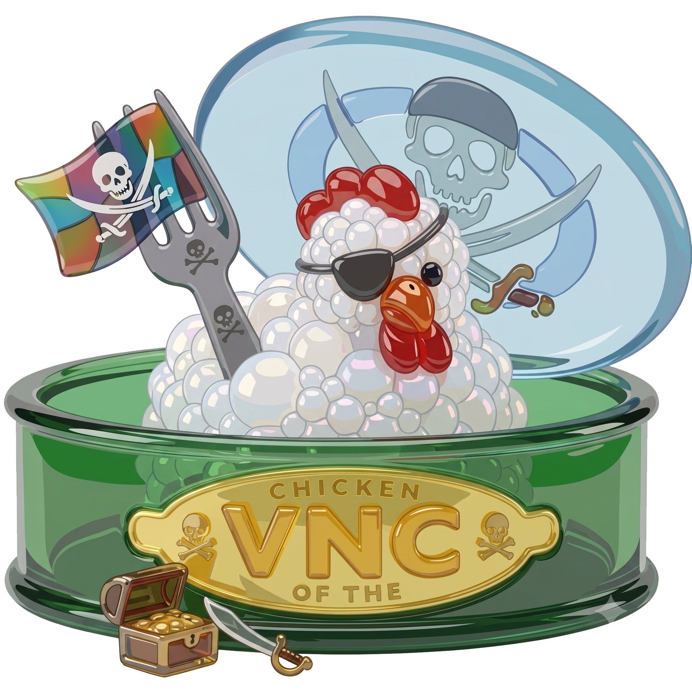

<p align="center">
  
</p>

# Chicken Fork

[](#)
[-blue.svg)](#)
[](LICENSE.md)

**Chicken Fork** is a modernized, high-performance, native VNC and RDP remote desktop client for macOS. Based on the classic *Chicken of the VNC* codebase, this fork updates the application to run natively and smoothly on modern macOS architectures (including Apple Silicon and Intel) and modern display configurations.

---

## 🚀 Major Updates & Modernizations (Since last Chicken release in 2011)

Chicken Fork has undergone significant modernization to enhance stability, display performance, OS integration, and compatibility:

* **Native Microsoft Remote Desktop (RDP) Support (2026.11)**: Integrated full RDP client capabilities powered by FreeRDP 3.32.2 and OpenSSL 3.x, supporting modern Windows Server and Windows 10/11 hosts with Network Level Authentication (NLA/CredSSP), TLS encryption, mouse cursor shape synchronization, and clipboard transfer.
* **Dynamic Desktop Resizing**: Added support for resizable session windows when connected to VNC servers that support dynamic desktop resizing.
* **Retina Display & High-DPI Stability**: Fixed an off-by-one boundary checking bug in framebuffer drawing that caused out-of-bounds memory access and crashes on Retina screens.
* **Automatic Clipboard Synchronization**: Synchronizes clipboard content automatically when the session window gains focus or right before sending middle mouse button events.
* **UTF-8 Extended Clipboard Support**: Added support for the VNC "extended-clipboard" protocol, allowing seamless copy-paste transfer of non-ASCII and UTF-8 characters between macOS and the VNC server.


### ⚙️ Architecture & Build Modernization
* **Universal Binary Support**: Build target configurations updated to compile a Universal App (native `arm64` for Apple Silicon and `x86_64` for Intel).

### 🎨 Groundbreaking Branding
* **The "Liquid Glass" Visual Revolution**: We retired the charmingly retro, pixelated chicken icon and replaced it with a brand-new, ultra-glossy **"Liquid Glass" logo**. Sporting translucent, eye-straining 3D glassmorphism, it depicts our beloved chicken mascot paired with a dinner fork. Does it improve connection latency, fix memory leaks, or reduce CPU usage? Absolutely not. But it does make the app look like a premium, VC-funded SaaS utility, which we all know is the real measure of software engineering excellence.
---

## 🌟 Key Features

* **Lightweight & Native Cocoa UI**: Built specifically for macOS, using native Cocoa controls for quick start times and minimal memory footprint.
* **Secure SSH Tunneling**: Easily establish secure connections to remote hosts through built-in SSH tunneling.
* **Fullscreen Mode**: Supports native macOS fullscreen mode for immersive remote management.
* **Multi-Connection Profile Manager**: Store and manage profiles for multiple servers, including keyboard profiles, color depth settings, and connection behaviors.

---

## 📝 Release Notes

* [Version 2026.11](release-notes/2026.11.md) — Product renamed to **Chicken Fork**, version bump to 2026.11, and FreeRDP 3.32.2 integration.
* [Version 2026.9](release-notes/2026.9.md) — Touch Bar support, Apple Remote Desktop (ARD) authentication, SSH passphrase guidance, and fullscreen space management fixes.
* [Version 2026.6](release-notes/2026.6.md) — Universal binary (Apple Silicon + Intel), dynamic desktop resizing, UTF-8 extended-clipboard, Retina display fixes, and application modernizations.

---

## 🛠️ Building Chicken Fork

### Prerequisites
* macOS 11.0 or later
* Xcode 12.0 or later

### Build Instructions
1. Clone the repository and initialize submodules:
   ```bash
   git clone https://github.com/ays7/chicken.git
   cd chicken
   ```
2. Open the Xcode project:
   ```bash
   open cotvnc/ChickenFork.xcodeproj
   ```
3. Select the scheme (e.g., **Chicken Fork**) and build/run (`Cmd + R`) or archive it to build the Universal release application.

### Distribution & Code Signing
For packaging signed and notarized `.dmg` releases for direct macOS distribution via GitHub Releases, refer to the [Apple Developer ID Code Signing & Notarization Guide](docs/developer-id-signing.md).

---

## 📄 License

Chicken Fork is distributed under the **GNU General Public License v2.0 or later** (GPL-2.0+). See [LICENSE.md](LICENSE.md) for details.

Precompiled release binaries bundling FreeRDP and OpenSSL (Apache 2.0) are distributed under **GNU General Public License v3.0** in accordance with Section 9 of the GPL-2.0 ("or later") clause.
